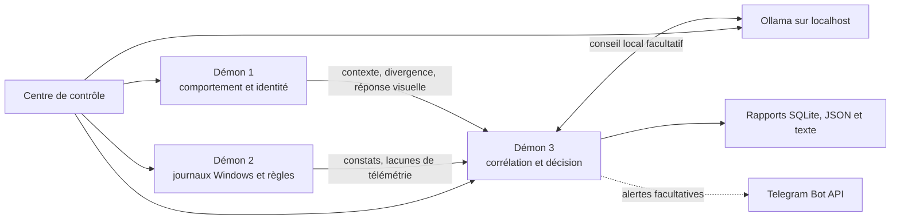

# SentinelCore

SentinelCore est un prototype Windows de surveillance locale qui rapproche trois sources : le contexte humain observé par D1, les événements techniques observés par D2 et l’évaluation de risque de D3. Le Centre de contrôle lance les composants et présente leur état.

> SentinelCore complète Microsoft Defender. Il ne le remplace pas : le confinement de fichiers, l’arrêt de processus et l’isolation réseau ne sont pas implémentés. Les scénarios de test sont synthétiques et ne mesurent pas un taux de détection réel.

## Architecture



Les échanges entre démons utilisent des enveloppes JSON versionnées et des `correlationId`. D3 héberge le Named Pipe `SentinelCore.Guard`. D1 et D2 s’y connectent avec les identités Windows autorisées; les transports JSONL servent aux tests et ne constituent pas une frontière de sécurité. Le contrat commun est décrit dans [`Contrat_Inter_Demons_v1.txt`](Contrat_Inter_Demons_v1.txt).

### Rôle des composants

- **D1 — identité et habitudes.** Après configuration et démarrage explicite, il compare des agrégats de frappe, de souris, d’applications, d’horaires et de ressources au profil choisi. Il ne conserve pas le texte tapé. À la demande de D3, le module visuel peut comparer une capture courte à un profil enrôlé et répondre avec un résultat corrélé. Un résultat visuel ne supprime jamais un signal technique de D2.
- **D2 — surveillance technique.** Il lit les journaux Windows configurés (Sysmon lorsqu’il est installé, événements Defender sélectionnés et PowerShell 4104), normalise les événements, applique des règles déterministes et enregistre les constats dans SQLite. Il signale aussi les sources absentes, les pertes et les données mal formées. D2 n’exécute pas de réponse et ne lance pas de commande système.
- **D3 — analyse, décision et réponse.** Il regroupe les constats par corrélation et enregistre une évaluation provisoire déterministe. Pour un cas ambigu, Ollama devient l’analyste du dossier : il examine les faits minimisés, peut demander des compléments autorisés à D1/D2, puis produit un verdict argumenté et une mesure typée. D3 valide ce verdict, applique les garde-fous non négociables (dont le maintien d’un plancher pour les alertes techniques D2) et n’exécute que les mesures du catalogue. Si Ollama est absent ou sa réponse invalide, D3 revient à ses règles déterministes. Le texte ou script proposé par le modèle reste non exécutable. L’analyse rapide Defender est la seule mesure active disponible et exige son activation explicite ainsi qu’une nouvelle autorisation du propriétaire.
- **Centre de contrôle.** Il authentifie l’accès avec les mécanismes D1 configurés, pilote les démons, affiche les activités D2/D3, expose les réglages Ollama et Telegram, et peut publier un setup autonome pour Windows.

### Flux d’un cas

1. D2 reçoit un événement Windows, le normalise et publie `THREAT_FINDING` ou `TELEMETRY_GAP` vers D3.
2. D1 peut répondre aux demandes de contexte ou d’identité de D3 avec le même identifiant de corrélation.
3. D3 sauvegarde une évaluation provisoire; pour un cas ambigu, Ollama analyse les faits, peut demander un contexte D1/D2 autorisé, puis fournit la décision et la mesure typée proposées. D3 conserve le verdict et ses justifications dans le rapport.
4. D3 vérifie chaque proposition IA selon le catalogue fermé, les invariants de risque, l’approbation, l’expiration et l’idempotence. La mesure autorisée et son résultat sont conservés dans le rapport.

## Prérequis

- Windows 10 ou 11, x64.
- SDK .NET 10 pour compiler depuis les sources.
- Ollama et un modèle local compatible sont facultatifs pour l’IA. Au démarrage de la surveillance, le Centre vérifie Ollama et lance `ollama.exe serve` en arrière-plan s’il n’est pas déjà actif. Il ne télécharge jamais le modèle. Sans Ollama ou sans le modèle choisi, D3 conserve son comportement de repli déterministe.
- Sysmon est facultatif pour le démarrage, mais nécessaire à plusieurs chaînes de visibilité détaillées de D2. Sans Sysmon, Defender et PowerShell peuvent encore fournir des événements; D2 doit alors afficher une couverture dégradée.
- Les modèles ONNX de vérification visuelle D1 sont facultatifs; le script documenté les télécharge avec validation de hachage.
- Inno Setup 6.7.4 est requis uniquement pour générer le setup.

## Compiler et démarrer

Depuis la racine du dépôt, dans PowerShell :

```powershell
dotnet build '.\Demon 1\SentinelCore.Demon1.slnx' --configuration Release
dotnet build '.\Demon 2\SentinelCore.Demon2.slnx' --configuration Release
dotnet build '.\Demon 3\DEMON 3\Demon3-Starter\SentinelCore.Demon3.slnx' --configuration Release
dotnet build '.\Control Center\SentinelCore.ControlCenter.slnx' --configuration Release
dotnet run --project '.\Control Center\SentinelCore.ControlCenter\SentinelCore.ControlCenter.csproj' --configuration Release
```

Le bouton de démarrage du Centre vérifie et démarre Ollama, puis lance D3 avant D2 et présente le panneau D1. Si le modèle choisi est absent, installe-le manuellement (par exemple `ollama pull gemma3:1b`); SentinelCore ne consomme pas de connexion pour télécharger des poids. D1 n’active pas la collecte simplement parce que le Centre s’ouvre : une authentification et une confirmation de démarrage restent nécessaires.

Pour créer un installateur autonome x64 avec l’icône SentinelCore :

```powershell
.\scripts\Build-SentinelCoreSetup.ps1
```

Le binaire généré se trouve dans `dist/`. Il n’est pas signé par défaut. Les sorties de compilation, paramètres locaux et fichiers de modèles téléchargés sont exclus par le `.gitignore`.

## Tests et scénarios

```powershell
dotnet run --project '.\Demon 1\tests\SentinelCore.Demon1.Tests\SentinelCore.Demon1.Tests.csproj' --configuration Release
dotnet run --project '.\Demon 2\tests\SentinelCore.Demon2.Tests\SentinelCore.Demon2.Tests.csproj' --configuration Release
dotnet test '.\Demon 3\DEMON 3\Demon3-Starter\tests\SentinelCore.Demon3.Tests\SentinelCore.Demon3.Tests.csproj' --configuration Release
.\scripts\Verify-InterDaemonTransport.ps1
```

D1 et D2 utilisent des exécutables de vérification console; D3 utilise xUnit. Le dernier audit a passé 93 contrôles D1, 19 groupes de contrôles D2 avec rejeu de 50 scénarios, et 53 tests D3. Ces nombres prouvent le comportement attendu face aux fixtures, pas la précision biométrique ou la performance de détection dans la nature. Le script de transport utilise des dossiers temporaires et vérifie un véritable échange local D2→D3; il ne lance pas la caméra ni une action de remédiation.

Les capacités et limites par rapport aux outils existants sont détaillées dans [`COMPARAISON_SOLUTIONS.md`](COMPARAISON_SOLUTIONS.md). Chaque module possède son propre guide : [D1](<Demon 1/README.md>), [D2](<Demon 2/README.md>), [D3](<Demon 3/DEMON 3/Demon3-Starter/README.md>) et [Centre de contrôle](<Control Center/README.md>).

## Rapports et alertes facultatives

D3 conserve les rapports localement dans `%LOCALAPPDATA%\SentinelCore\Demon3\reports`. Il crée un rapport d’ouverture quand D3 démarre, un instantané périodique toutes les cinq minutes, puis un rapport de clôture à l’arrêt propre. Les événements reçus sont journalisés au fil de l’eau. Le bouton **Rapports et instantané** ouvre l’historique et permet de créer un rapport à la demande, même sans menace. Le démarrage D3 est postérieur à l’ouverture de la session Windows : l’heure de démarrage du PC affichée est estimée à partir de Windows, ce rapport ne s’exécute pas avant la connexion.

Un arrêt normal via le Centre, `STOP` ou la fermeture du canal d’entrée de D3 déclenche le rapport final. Une coupure de courant ou un arrêt forcé peut empêcher ce dernier fichier; les écritures d’événements et les instantanés périodiques réduisent la perte, et une session inachevée est marquée interrompue au prochain démarrage de D3. Les rapports sont conservés localement dans `%LOCALAPPDATA%\SentinelCore\Demon3\reports`. L’intégration Telegram peut transmettre un PDF au chat configuré; elle reste désactivée tant qu’un Bot API token et un chat ID ne sont pas renseignés dans Configuration. Le token est protégé par DPAPI pour le compte Windows courant. Un PDF peut contenir l’image de vérification visuelle : il est alors transmis au service Telegram et au chat choisi.

## Données et limites de sécurité

- Les modèles Ollama sont appelés sur l’API locale `http://127.0.0.1:11434`; aucune action ne dépend d’un compte Google connecté à l’application Ollama.
- Les règles D1/D2 sont déterministes et leurs fixtures sont des exemples de test; aucun apprentissage automatique de détection de malware n’est entraîné avec ces fichiers.
- Sysmon, les journaux Windows, les ACL et l’identité de service doivent être configurés et validés sur chaque poste. Leur présence n’est pas présumée.
- Les actions de confinement, quarantaine, arrêt de processus, filtrage réseau et récupération après plantage ne sont pas disponibles.
- Les identifiants, photos, journaux et rapports locaux nécessitent une politique de conservation et des ACL appropriées. Ne commitez jamais de mots de passe, tokens, captures réelles ou configuration DPAPI.

Documentation de référence : [événements Sysmon](https://learn.microsoft.com/en-us/windows/security/operating-system-security/sysmon/sysmon-events), [API Ollama](https://docs.ollama.com/api/introduction) et [Telegram Bot API](https://core.telegram.org/bots/api).
